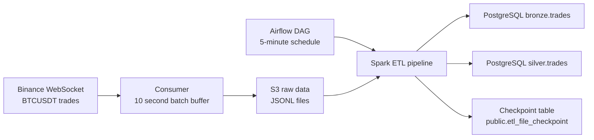

# Batch Streaming for Binance Trades

This project builds a lightweight data pipeline for Binance BTC/USDT trade data. It consumes the live WebSocket stream, batches messages into JSONL files in S3, and loads them into PostgreSQL using a Spark-based ETL process. The repository also includes Airflow scheduling, checkpointing, and a Streamlit dashboard for monitoring the latest market activity.

## Project goals

- Collect real-time Binance trade events from the BTC/USDT stream
- Buffer and persist raw trades in S3 using UTC-based partitions
- Process new or changed files incrementally with Spark
- Publish results into PostgreSQL Bronze and Silver layers
- Support backfills and scheduled runs via Airflow
- Provide a simple operational dashboard for trade monitoring

## Architecture



The Bronze layer stores raw values as loaded from S3. The Silver layer then enriches the same records with typed decimals, derived metrics, and partition keys for analysis. The Silver transformation reads the source files directly rather than re-reading Bronze data from PostgreSQL.

## Repository structure

- `consumer/` — WebSocket client, buffering, and S3 upload logic
- `etl/` — S3 object selection, Spark schema, transformation, and PostgreSQL writes
- `db/` — database connection helpers
- `dags/` — Airflow DAG definitions for incremental and backfill processing
- `dashboard/` — Streamlit dashboard for recent trade monitoring
- `config/` — global settings and environment defaults
- `sql/` — database schema setup
- `tests/` — focused validation tests
- `main_consumer.py` — entry point for the stream consumer
- `main_etl.py` — entry point for the ETL run
- `docker-compose.yml` — local orchestration for services

## Data flow

1. `consumer/websocket_client.py` connects to `wss://stream.binance.com:9443/ws/btcusdt@trade`.
2. `consumer/consumer.py` normalizes each trade into a compact record containing `trade_id`, `event_time`, `symbol`, `price`, `quantity`, and `is_buyer_maker`.
3. `consumer/writer.py` writes each batch as one JSON object per line and uploads the file to S3 under a UTC partition such as:

```text
raw/binance/trades/year=2026/month=10/day=21/20261021_143000_123456.jsonl
```

4. `etl/bronze_reader.py` lists S3 objects, compares them with the checkpoint table, and downloads only new or changed files.
5. `etl/bronze_writer.py` writes raw rows to `bronze.trades`.
6. `etl/transformer.py` converts timestamps and numeric values into analytic types, then adds `trade_value` and `trade_date`.
7. `etl/silver_writer.py` writes the transformed data into `silver.trades` and deduplicates conflicting records.
8. `etl/pipeline.py` checkpoints processed S3 object keys and ETags only after both Bronze and Silver writes succeed.

## Tech stack

- Python 3.11 / 3.12
- WebSocket client: `websocket-client`
- AWS SDK: `boto3`
- Data processing: Apache Spark 4.1.2
- Database: PostgreSQL 16
- Orchestration: Docker Compose + Apache Airflow
- Dashboard: Streamlit + Plotly

## Prerequisites

You need:

- Docker Engine and Docker Compose
- AWS credentials for a profile such as `batch-streaming`
- A target S3 bucket in `ap-southeast-1`
- Internet access to Binance and Amazon S3

The project reads AWS credentials from a mounted host directory such as `${HOME}/.aws` and expects an AWS profile configured in `AWS_PROFILE`.

## Environment variables

Main defaults are defined in `config/settings.py`:

- `POSTGRES_HOST` — default `localhost`
- `POSTGRES_PORT` — default `5432`
- `POSTGRES_DB` — default `batch_streaming`
- `POSTGRES_USER` — default `postgres`
- `POSTGRES_PASSWORD` — default `postgres`
- `S3_BUCKET` — default `batch-streaming-bronze`
- `S3_RAW_PREFIX` — default `raw/binance/trades`
- `AWS_REGION` — default `ap-southeast-1`
- `SAVE_INTERVAL` — fixed at 10 seconds

Example environment file:

```env
AWS_HOST_DIR=/home/your-user/.aws
AWS_PROFILE=batch-streaming
```

## Database setup

The repository initializes PostgreSQL schemas in `sql/init.sql`, but the checkpoint table is created separately because it is used at runtime by the ETL process.

Create the checkpoint table before running ETL for the first time:

```sql
CREATE TABLE IF NOT EXISTS public.etl_file_checkpoint (
    object_key TEXT PRIMARY KEY,
    etag TEXT NOT NULL,
    processed_at TIMESTAMPTZ NOT NULL DEFAULT NOW()
);
```

Important notes:

- Compose creates the `batch_streaming` database for the pipeline.
- Airflow stores its metadata in a separate database named `airflow`.
- `sql/init.sql` creates the `gold` schema but the project does not yet implement a Gold processing layer.

## Run with Docker Compose

Start PostgreSQL:

```bash
docker compose up -d postgres
```

Build and run the ETL once:

```bash
docker compose build etl consumer
docker compose run --rm etl
```

Start the live consumer and let it upload batches to S3:

```bash
docker compose up -d consumer
docker compose logs -f consumer
```

Stop the consumer when needed:

```bash
docker compose stop consumer
```

### Airflow scheduler

Launch the Airflow service stack:

```bash
docker compose up -d airflow-init airflow-webserver airflow-scheduler
```

The web UI is available at:

- http://localhost:8080
- login: `admin` / `admin`

The repository includes:

- `batch_streaming_etl` — scheduled ETL job every 5 minutes
- `batch_streaming_backfill` — manual backfill for specific date ranges

### pgAdmin

The database management UI is exposed at:

- http://localhost:5050

### Streamlit dashboard

```bash
docker compose up -d streamlit
```

Then open:

- http://localhost:8501

The dashboard connects to PostgreSQL and shows price, volume, maker/taker activity, and recent trade rows.

## Local execution

If you prefer to run the project without Docker, install the dependencies and start the consumer and ETL in separate terminal sessions:

```bash
python main_consumer.py
python main_etl.py
```

The consumer keeps running in the foreground, while the ETL job processes all currently eligible S3 files once and exits.

## Validation queries

Use the following SQL to inspect the data after ETL runs:

```sql
SELECT trade_id, event_time_ms, symbol, price, quantity, buyer_maker, ingested_at
FROM bronze.trades
ORDER BY event_time_ms DESC
LIMIT 20;

SELECT trade_id, event_time, symbol, price, quantity, trade_value, trade_date
FROM silver.trades
ORDER BY event_time DESC
LIMIT 20;

SELECT 'bronze' AS layer, COUNT(*) AS rows FROM bronze.trades
UNION ALL
SELECT 'silver', COUNT(*) FROM silver.trades;

SELECT trade_id, COUNT(*)
FROM bronze.trades
GROUP BY trade_id
HAVING COUNT(*) > 1;

SELECT trade_id, COUNT(*)
FROM silver.trades
GROUP BY trade_id
HAVING COUNT(*) > 1;

SELECT object_key, etag, processed_at
FROM public.etl_file_checkpoint
ORDER BY processed_at DESC
LIMIT 20;
```

## Useful operational scripts

- `run_full_backfill.sh` — replays a date range while respecting checkpoint state
- `audit_s3_partition.py` — scans raw S3 files and reports duplicate or malformed records
- `tests/` — verifies object date parsing, filter logic, and transformation behavior

## Common gotchas

- `public.etl_file_checkpoint` is not created by `sql/init.sql`; create it manually before the first run.
- `AWS_HOST_DIR` must point to a valid AWS credentials directory on the host machine.
- Backfills should usually set `BACKFILL_IGNORE_CHECKPOINT` only when you intend to reprocess historical data.
- If Airflow is enabled, ensure the `airflow` database exists before the `airflow-init` service runs.

## Logs and troubleshooting

```bash
docker compose logs -f postgres
docker compose logs -f consumer
docker compose logs -f etl
docker compose logs -f airflow-scheduler airflow-webserver
```

These commands are useful for checking whether the consumer is receiving WebSocket messages, whether S3 upload batches are being created, and whether the ETL is processing the expected files.

## Summary

This repository demonstrates a practical batch-streaming pipeline for market data: ingest from a live exchange stream, persist raw files in S3, process with Spark, land results in PostgreSQL, and monitor the pipeline with Airflow and a lightweight dashboard.
