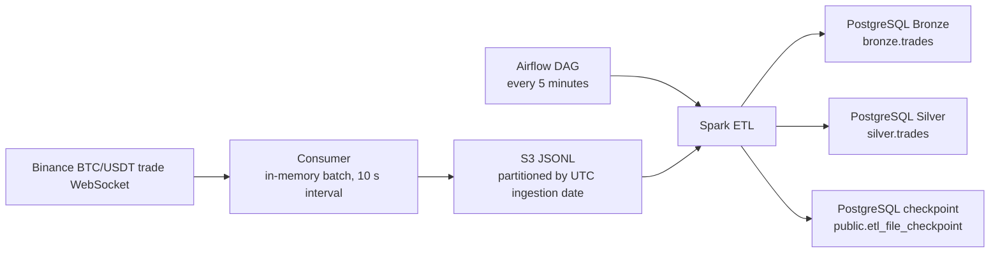

# Binance Trade Batch Streaming

A batch streaming pipeline for Binance BTC/USDT trades. A WebSocket consumer buffers trades into JSONL files on S3; a Spark job loads new or changed files into PostgreSQL Bronze and Silver tables.

## Architecture



Bronze and Silver are both built from the selected S3 files. The Silver transformation does not read back from the Bronze table.

## Data flow

1. `consumer/websocket_client.py` connects to `wss://stream.binance.com:9443/ws/btcusdt@trade`. Each trade is normalized to `trade_id`, event time in milliseconds, symbol, price, quantity, and buyer-maker flag.
2. `consumer/consumer.py` buffers messages until the 10-second save interval. `consumer/writer.py` writes one JSON object per line and uploads a file under `raw/binance/trades/year=YYYY/month=MM/day=DD/`. These path partitions use UTC **ingestion** date.
3. `etl/bronze_reader.py` lists JSONL files and compares each key and ETag with `public.etl_file_checkpoint`. New and changed objects are downloaded to a temporary directory and read by Spark with an explicit schema.
4. `etl/bronze_writer.py` stores the raw values in `bronze.trades`, preserving event time as milliseconds and price/quantity as strings.
5. `etl/transformer.py` converts event time to a timestamp and price/quantity to fixed precision decimals. It derives `trade_value = price * quantity` and `trade_date`; `etl/silver_writer.py` stores these in `silver.trades`.
6. After both writes succeed, `etl/pipeline.py` stores the object keys and ETags as checkpoints. Replayed trade IDs are ignored at both targets by primary keys and `ON CONFLICT (trade_id) DO NOTHING`.

Checkpointing is object-level and takes place after both layer writes. The consumer's current batch is only in memory and there is no shutdown flush handler.

## Components

| Path | Role |
| --- | --- |
| `docker-compose.yml` | PostgreSQL, ETL, pgAdmin, consumer, and Airflow services |
| `consumer/` | Binance connection, trade normalization, and S3 upload |
| `etl/` | S3 file selection, Spark schema/transformation, PostgreSQL writers |
| `dags/batch_streaming_etl.py` | Five-minute DockerOperator ETL schedule |
| `sql/init.sql` | Creates Bronze and Silver schemas/tables (and an empty Gold schema) |
| `config/settings.py` | Connection defaults, S3 settings, socket URL, save interval |
| `main_consumer.py`, `main_etl.py` | Application entry points |

## Prerequisites

- Docker Engine and Docker Compose.
- An AWS credentials/configuration directory with a `batch-streaming` profile and permission to list, read, and write in the target S3 bucket.
- The configured bucket (Compose default: `batch-streaming-bronze`) in `ap-southeast-1`.
- Network access to Binance and S3.

Compose mounts `\${HOME}/.aws` read-only for the consumer and ETL. The DAG separately hard-codes `/home/alva_ngo/.aws` as the host mount source; update that path for your Docker host. The DAG also hard-codes the Docker network name `batch-streaming_default`.

## Setup caveats in the current repository

- The ETL reads and writes `public.etl_file_checkpoint`, but `sql/init.sql` does not create it. Create it in the `batch_streaming` database before the first ETL run:

```sql
CREATE TABLE IF NOT EXISTS public.etl_file_checkpoint (
    object_key TEXT PRIMARY KEY,
    etag TEXT NOT NULL,
    processed_at TIMESTAMPTZ NOT NULL DEFAULT NOW()
);
```

- Compose initializes PostgreSQL with database `batch_streaming`, while Airflow's SQLAlchemy connection points to a separate database named `airflow`. The Compose configuration does not create that database; Airflow initialization may fail until it is provisioned.
- `sql/init.sql` creates a `gold` schema but the source contains no Gold table or processing step.
- The S3 bucket and AWS profile must already exist and be accessible. The consumer and ETL use boto3 credentials from the mounted profile.

## Run with Docker Compose

Start PostgreSQL:

```sh
docker compose up -d postgres
```

On first startup with a new `postgres_data` volume, the Postgres image runs `sql/init.sql`. Existing volumes are not reinitialized by later edits. Connect to database `batch_streaming` on `localhost:5432` as `postgres`, then create the checkpoint table shown above.

Build the application image and run ETL once:

```sh
docker compose build etl consumer
docker compose run --rm etl
```

With no unseen or changed S3 objects, the ETL reports that there are no new files and exits. Start the live consumer to begin producing files:

```sh
docker compose up -d consumer
docker compose logs -f consumer
```

Stop it with `docker compose stop consumer`. The configured ETL service is a one-shot invocation of `main_etl.py`; Airflow is intended to repeat it every five minutes.

To use Airflow, first resolve the database and host-path caveats above. Then:

```sh
docker compose up -d airflow-init airflow-webserver airflow-scheduler
```

The webserver is published at [http://localhost:8080](http://localhost:8080). Compose configures the login as `admin` / `admin`. The DAG launches the prebuilt `batch-streaming:latest` image via DockerOperator, so build it with `docker compose build etl` first. pgAdmin is published at [http://localhost:5050](http://localhost:5050); its configured login values are in `docker-compose.yml`.

## Run locally

The application image installs Python dependencies, Java 21, PySpark 4.1.2, and PostgreSQL JDBC driver at `/opt/jdbc/postgresql-42.7.8.jar`. For a local run, provide equivalent dependencies, AWS credentials, and PostgreSQL environment variables, then run the consumer and ETL in separate terminals:

```sh
python main_consumer.py
python main_etl.py
```

The consumer command runs continuously; the ETL command processes available new/changed objects once. Python defaults are PostgreSQL host `localhost`, port `5432`, database `batch_streaming`, and user/password `postgres`.

## Validate the data

Run these against the `batch_streaming` database:

```sql
-- Recent raw Bronze rows
SELECT trade_id, event_time_ms, symbol, price, quantity, buyer_maker, ingested_at
FROM bronze.trades
ORDER BY event_time_ms DESC
LIMIT 20;

-- Recent typed Silver rows and derived values
SELECT trade_id, event_time, symbol, price, quantity, trade_value, trade_date
FROM silver.trades
ORDER BY event_time DESC
LIMIT 20;

-- Compare layer counts
SELECT 'bronze' AS layer, COUNT(*) AS rows FROM bronze.trades
UNION ALL
SELECT 'silver', COUNT(*) FROM silver.trades;

-- Duplicate checks (expected to return no rows)
SELECT trade_id, COUNT(*) FROM bronze.trades
GROUP BY trade_id HAVING COUNT(*) > 1;

SELECT trade_id, COUNT(*) FROM silver.trades
GROUP BY trade_id HAVING COUNT(*) > 1;

-- Checkpointed objects
SELECT object_key, etag, processed_at
FROM public.etl_file_checkpoint
ORDER BY processed_at DESC
LIMIT 20;

-- Daily trade count and notional by symbol
SELECT trade_date, symbol, COUNT(*) AS trades, SUM(trade_value) AS notional
FROM silver.trades
GROUP BY trade_date, symbol
ORDER BY trade_date DESC, symbol;
```

Follow service logs with:

```sh
docker compose logs -f postgres
docker compose logs -f consumer
docker compose logs -f etl
docker compose logs -f airflow-scheduler airflow-webserver
```

## Configuration

| Variable | Default / Compose value | Purpose |
| --- | --- | --- |
| `POSTGRES_HOST` | Python: `localhost`; Compose ETL: `postgres` | PostgreSQL host |
| `POSTGRES_PORT` | `5432` | PostgreSQL port |
| `POSTGRES_DB` | `batch_streaming` | ETL database |
| `POSTGRES_USER`, `POSTGRES_PASSWORD` | `postgres`, `postgres` | Database credentials |
| `AWS_PROFILE` | `batch-streaming` in Compose | boto3 profile |
| `AWS_REGION` | `ap-southeast-1` | S3 region |
| `S3_BUCKET` | `batch-streaming-bronze` | S3 bucket |
| `S3_RAW_PREFIX` | `raw/binance/trades` | S3 object prefix |

The 10-second `SAVE_INTERVAL` is a constant in `config/settings.py`, not an environment variable.
